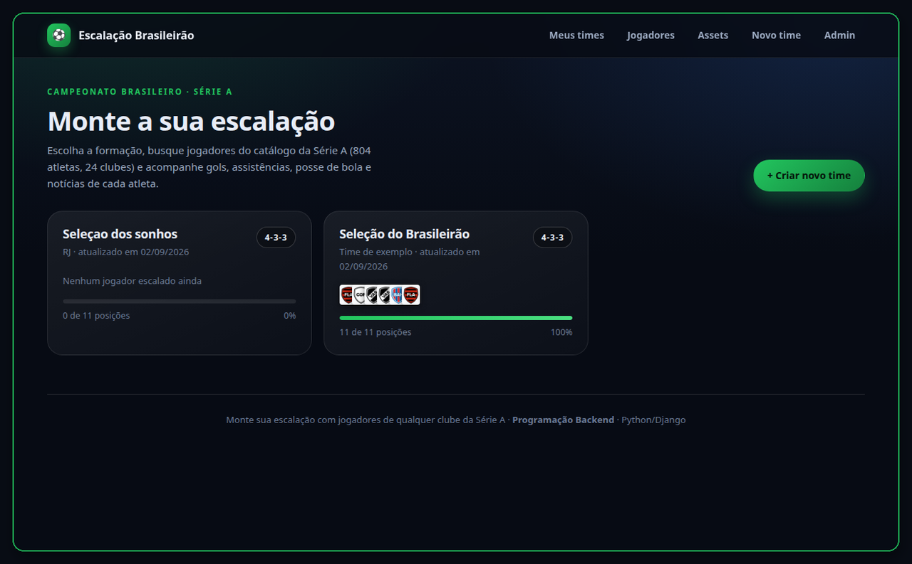
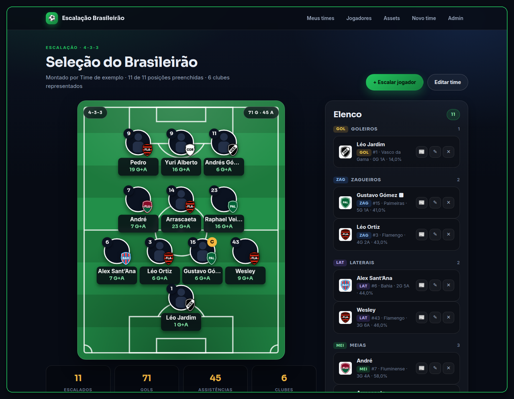
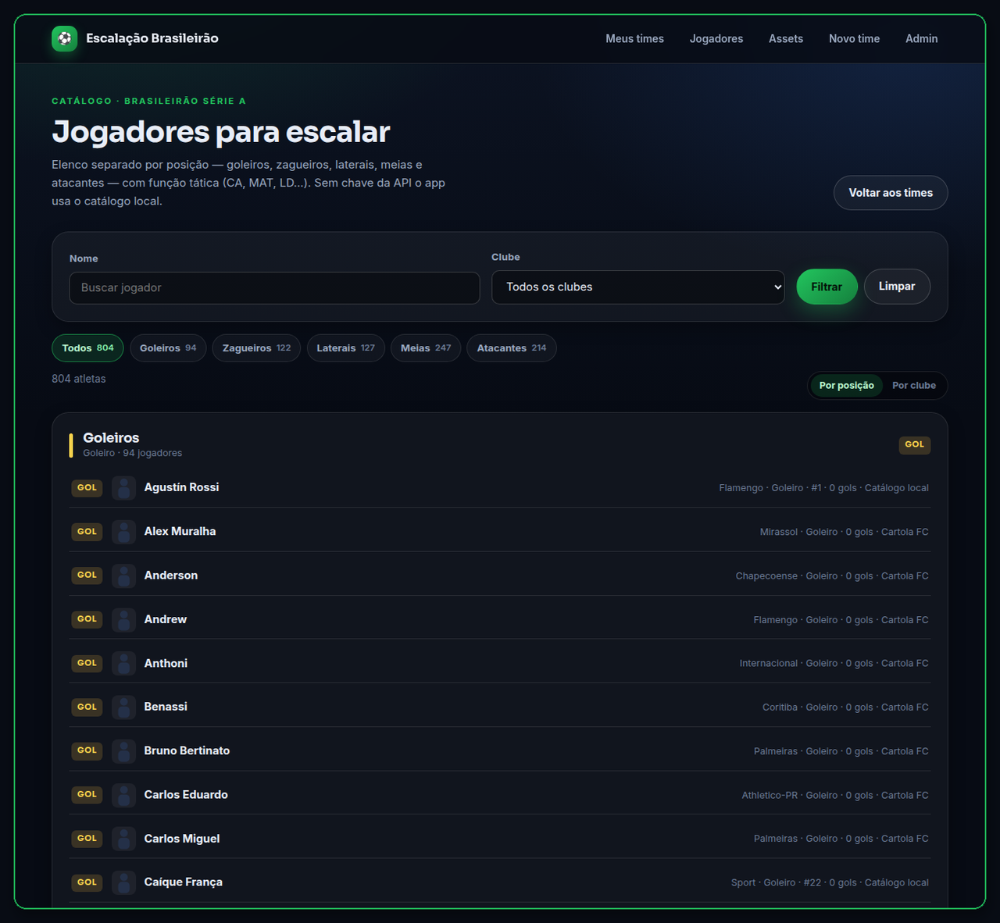
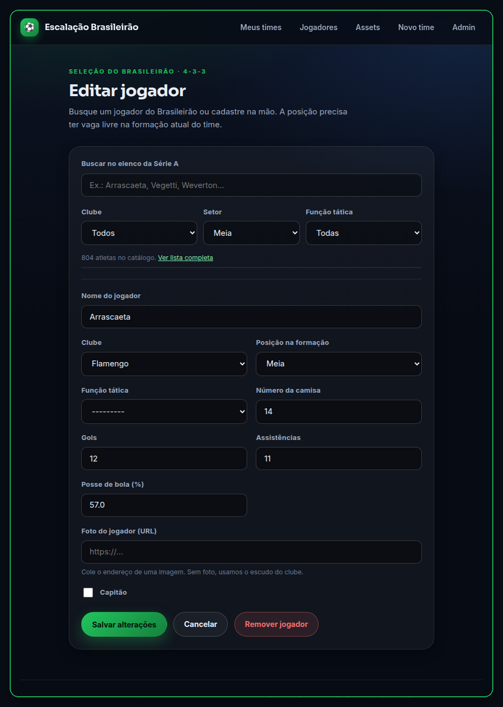

<div align="center">

# 🎮 ProLobby

**Matchmaking e comunidade pra EA FC Pro Clubs**


[📋 O que é](#-o-que-é) ·
[🎯 Como funciona](#-como-funciona) ·
[✨ Funcionalidades](#-funcionalidades) ·
[📁 Documentação](#-documentação) ·
[🚧 Estado atual](#-estado-atual) ·
[👥 Time](#-time)

</div>

---

## 📋 O que é

Você entra numa fila pela sua posição (goleiro, zaga, meio, ponta, ataque),
o sistema forma dois times de 11 equilibrados por elo, e a plataforma
coordena tudo — Discord, resultado, ranking — enquanto a partida acontece
dentro do próprio EA FC.

A identidade visual (cores, fontes, raios, sombras) é herdada do design
system do projeto [`escalacao-brasileirao`](https://github.com/rafaeljs08/escalacao-brasileirao) —
mas ProLobby é um **projeto novo e independente**, sem reaproveitar
backend/dados de lá.

---

## 🎯 Como funciona

```
1. Cadastro         → verifica personagem por print + OCR (sem API oficial da EA)
2. Fila              → escolhe posição, entra na fila individual
3. Lobby              → 22 jogadores confirmados, 2 times equilibrados por elo
4. Capitão            → 1 de cada lado, escolhido por reputação, empresta o
                        próprio clube EA pra reunir o time (sem API, sem "host" —
                        Pro Clubs roda em servidor dedicado, não P2P)
5. Partida            → Amistoso Online entre os dois clubes, dentro do jogo
6. Resultado          → print + OCR confirmam placar, elo e reputação atualizam
```

O ponto mais delicado do produto — como 22 estranhos viram uma partida real
dentro do Pro Clubs, já que o jogo não tem "sala privada avulsa" — está
documentado em detalhe em
[`mecânica real do EA FC Pro Clubs`](docs/produto/dossie/03-partida/00-mecanica-pro-clubs.md),
incluindo o que já foi confirmado por pesquisa e o que falta testar na prática.

---

## ✨ Funcionalidades

Levantadas e detalhadas no [dossiê de produto](docs/produto/dossie/README.md),
cada uma marcada por fase (MVP / Fase 2 / Futuro):

| Área | Recurso |
|------|---------|
| **Identidade** | Cadastro de personagem verificado por print + OCR |
| **Matchmaking** | Fila por posição, times equilibrados por elo/categoria |
| **Partida** | Capitão dinâmico (jogador real, escolhido por reputação) + coordenação via Discord |
| **Resultado** | Report com print/OCR, zero report penalizado, bloqueio em disputa |
| **Ranking** | Elo por categoria, reputação, seed inicial, punição a smurfing/conluio |
| **Governança** | Moderação, LGPD, termos de uso e idade mínima |
| **Social** | Perfil e visibilidade pública (elo, reputação, histórico) |
| **Onboarding** | Fluxo guiado: conta → personagem → Discord |

Itens deliberadamente adiados (aposta em dinheiro, moderador comunitário,
fila por time pré-formado, stack técnica) estão listados no
[backlog de fases futuras](docs/produto/dossie/05-produto/10-backlog-fases-futuras.md).

---

## 🖼️ Preview do produto

Artifact navegável com fila, lobby (capitão + 2 times), report de
resultado, perfil público e ranking — usando o design system real do
projeto. Dados são exemplo.

*(link do artifact publicado — atualizado conforme o design evolui)*

---

## 🤖 Discord

Servidor da comunidade é domínio próprio, documentado à parte do dossiê de
produto — cargos, canais, e o bot que automatiza tudo (cargo Verificado,
canais de lobby, notificações, moderação):

- [`docs/discord/`](docs/discord/README.md)

---

## 🎬 Referência visual

ProLobby ainda não tem UI própria — a identidade visual (cores, fontes,
raios, sombras) foi herdada do design system do projeto
[`escalacao-brasileirao`](https://github.com/rafaeljs08/escalacao-brasileirao).
Vídeo e capturas abaixo são as telas **desse** projeto de origem, não do
ProLobby, servindo só de referência de estilo:

<p align="center">
  <video src="docs/assets/demo-escalacao.mp4" width="920" autoplay loop muted playsinline></video>
</p>

<p align="center">
  
  
</p>
<p align="center">
  
  
</p>

---

## 📁 Documentação

- [`docs/`](docs/README.md) — índice geral da documentação
- [`docs/produto/dossie/`](docs/produto/dossie/README.md) — dossiê completo de produto, separado por nicho (visão, jogador, partida, governança, escopo)
- [`docs/discord/`](docs/discord/README.md) — estrutura do servidor Discord e do bot
- [`HANDOFF.md`](HANDOFF.md) — pra retomar o trabalho em outra sessão/máquina, leia primeiro

---

## 🚧 Estado atual

Fase de **design de produto** (levantamento de requisitos) — ainda sem
código de aplicação. O mecanismo central de partida (capitão + clube
dinâmico) já está decidido, mas falta um **teste prático no jogo** pra
confirmar detalhes de tempo/fricção — checklist em
[`00-mecanica-pro-clubs.md`](docs/produto/dossie/03-partida/00-mecanica-pro-clubs.md).
Stack técnica é a próxima decisão grande em aberto; divisão de papéis no
time já foi decidida (sem papel fixo, trabalho em conjunto).

Trabalho corre na branch `dev`; `main` só recebe merge quando o time decidir
promover.

---

## 👥 Time

Luciano, Rafael, João, Felipe.

<div align="center">

*Em design de produto · 2026*

</div>
