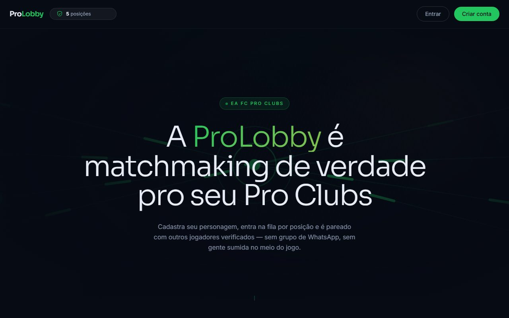
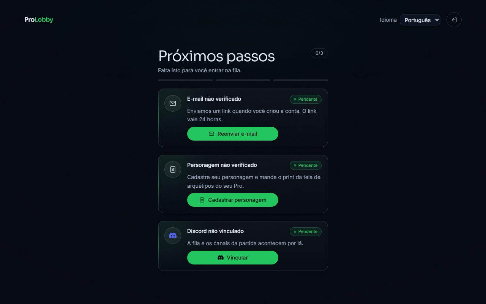
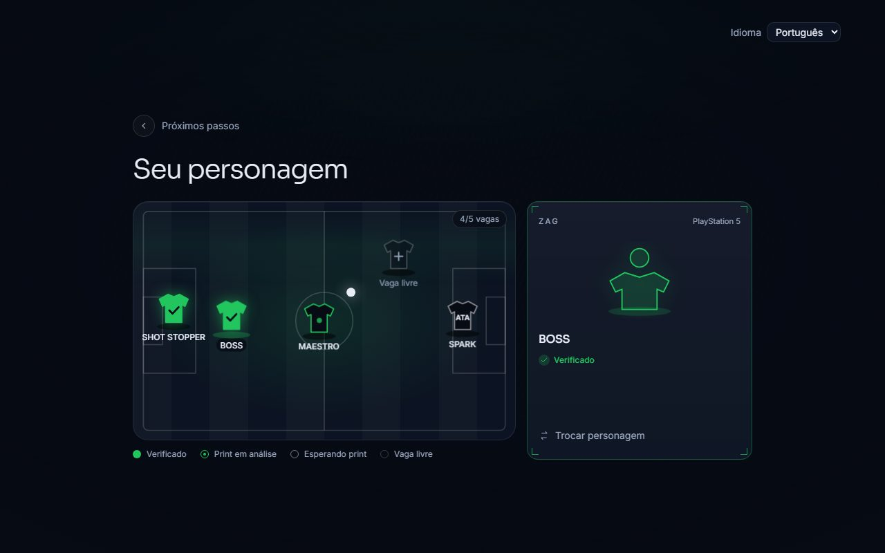
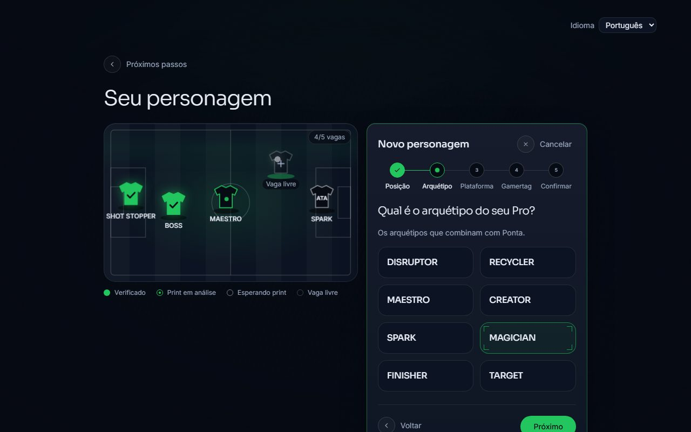
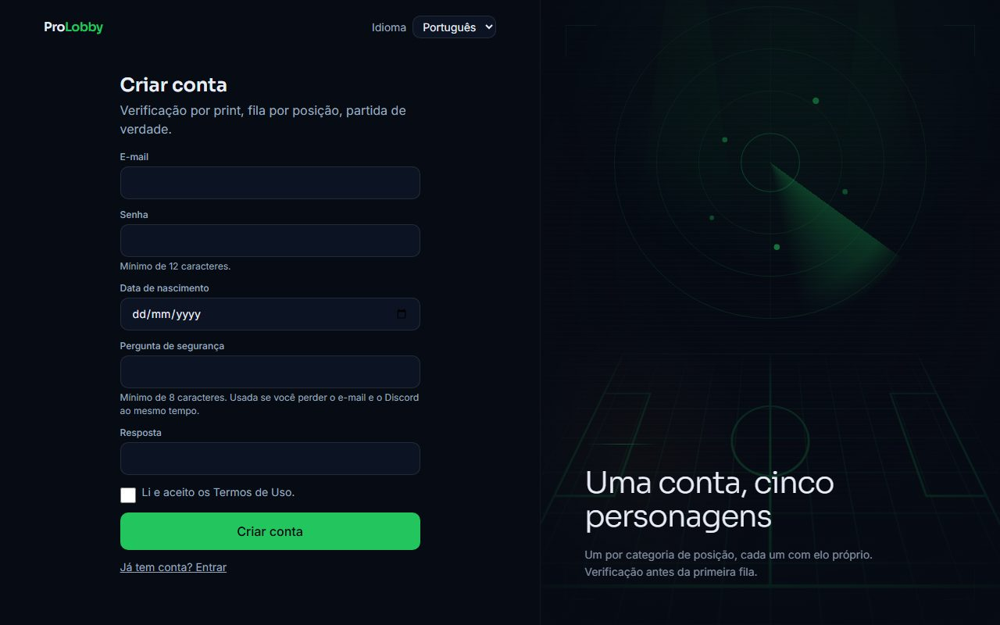
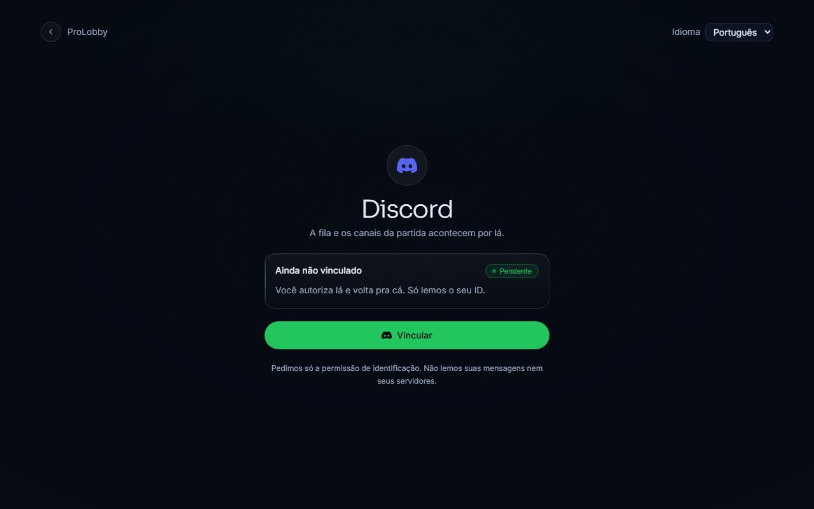
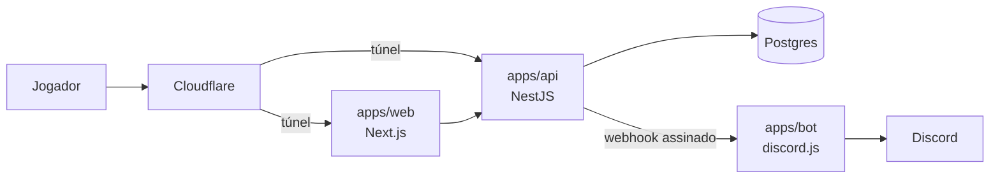

<div align="center">

# ProLobby

**Matchmaking competitivo e identidade verificada para EA FC Pro Clubs**

[](https://github.com/ljborgess/ProLobby.com/actions/workflows/ci.yml)


</div>

---

## Sobre

O jogador solo de Pro Clubs cadastra o personagem, prova que ele é dele com um print do jogo, entra
na fila pela posição que joga e é pareado com outros jogadores verificados. A partida acontece dentro
do EA FC. A plataforma organiza, verifica e mede.

## Como funciona

| Etapa | O que acontece |
|---|---|
| **1. Personagem** | Até 5 por conta, um por posição. O print da tela `Archetypes` prova a posse: o arquétipo aberto e o gamertag embaixo do card |
| **2. Fila** | Entrada individual por posição: goleiro, zaga, meio, ponta ou ataque |
| **3. Matchmaking** | Dois lados equilibrados por elo, posição contra posição. A IA do jogo completa as vagas vazias |
| **4. Lobby** | Um capitão por lado, pela reputação. O bot cria os canais de voz no Discord |
| **5. Resultado** | Print da tela final confirma o placar. Elo e reputação atualizam |

As regras completas, com o motivo de cada uma, estão no [dossiê de produto](docs/produto/README.md).

## As telas

Capturas do ambiente de desenvolvimento, com contas de teste. Toda a ilustração é desenhada em SVG e
CSS: nada de print ou arte do EA FC.

| | |
|---|---|
|  |  |
| **Início** | **Próximos passos**: o que falta pra entrar na fila |
|  |  |
| **Elenco**: as cinco posições no campo | **Cadastro do personagem**, a partir da vaga |
|  |  |
| **Criar conta** | **Vínculo com o Discord** |

## Status

| Fase | Estado |
|---|---|
| 2.1 Conta e autenticação | Em `dev` |
| 2.2 Personagem verificado por print | Em `dev`. A moderação confere cada print até o OCR entrar ([#199](https://github.com/ljborgess/ProLobby.com/issues/199)) |
| 2.3 Vínculo com o Discord | Em `dev` |
| 2.4 Elo e reputação | Em construção ([#53](https://github.com/ljborgess/ProLobby.com/issues/53)) |
| 2.5 Fila e matchmaking | A seguir |

Roadmap completo no [PRD Mestre](https://github.com/ljborgess/ProLobby.com/issues/64).

## Arquitetura



A API concentra a regra de negócio. O front-end não decide autorização, e o bot só executa o que a
API manda. Monorepo com Turborepo e pnpm; decisões em [ADRs](docs/adr/README.md).

## Começando

Requer Node.js 22, pnpm 10 e Docker.

```bash
git clone git@github.com:ljborgess/ProLobby.com.git && cd ProLobby.com
git checkout dev && pnpm install
docker compose up -d postgres            # porta ocupada? POSTGRES_PORT=5442 docker compose up -d postgres
cp apps/api/.env.example apps/api/.env
cp apps/bot/.env.example apps/bot/.env   # preencha os segredos (abaixo)
pnpm --filter @prolobby/api mikro-orm migration:up
pnpm dev                                 # web :3000 · api :3001 · bot :3002
```

Segredos obrigatórios da API: `JWT_SECRET` e `WEBHOOK_SECRET` (`openssl rand -base64 48`),
`EVIDENCE_ENCRYPTION_KEY` e `IDENTITY_HMAC_SECRET` (`openssl rand -base64 32`). A API não sobe com
valor vazio ou de exemplo.

Qualidade: `pnpm format:check`, `pnpm lint`, `pnpm type-check`, `pnpm test` e `pnpm e2e`. O e2e só roda
em banco cujo nome termina em `_e2e`.

## Documentação

| | |
|---|---|
| [Guia do time](docs/time/README.md) | Primeiro dia, fluxo de issue, recados |
| [Produto](docs/produto/README.md) · [Parâmetros](docs/produto/parametros.md) | Regras e todos os números do sistema |
| [Requisitos](docs/requisitos/README.md) · [Segurança](docs/requisitos/08-seguranca-checklist.md) | Requisitos, modelo de dados e checklist de segurança |
| [Negócio](docs/negocio/README.md) | Mercado, ordem de implementação e lançamento |

Pra contribuir, siga o [`CONTRIBUTING.md`](CONTRIBUTING.md).

## Licença

Projeto privado. Todos os direitos reservados aos sócios.
