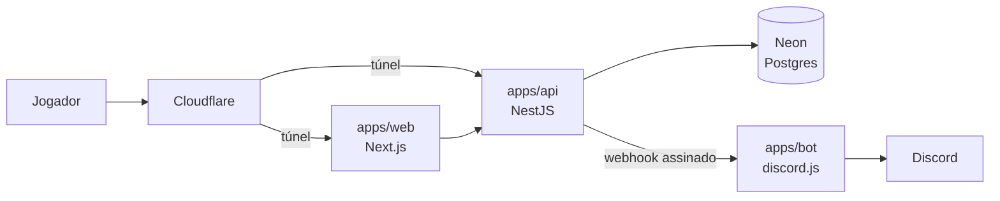

<div align="center">

# ProLobby

**Matchmaking competitivo e identidade verificada para EA FC Pro Clubs**

[](https://github.com/ljborgess/ProLobby.com/actions/workflows/ci.yml)


[Como funciona](#como-funciona) · [Arquitetura](#arquitetura) · [Começando](#começando) ·
[Documentação](#documentação) · [Contribuindo](#contribuindo)

</div>

---

## Sobre

O ProLobby transforma a fila individual em partida organizada de Pro Clubs. O jogador entra na
fila pela posição que joga, o sistema monta dois times equilibrados por elo e coordena o resto:
capitão, canais de voz no Discord, validação do resultado e ranking.

A partida acontece dentro do EA FC. A plataforma não executa o jogo: organiza, verifica e mede.

## Como funciona

| Etapa | O que acontece |
|---|---|
| **1. Identidade** | O jogador envia o print do Virtual Pro; OCR extrai overall, posição e gamertag. Sem API pública da EA, toda verificação é evidência |
| **2. Fila** | Entrada individual por categoria: goleiro, zaga, meio, ponta ou ataque |
| **3. Matchmaking** | Dois lados equilibrados por elo, categoria contra categoria, com simetria obrigatória. A IA do jogo completa as vagas vazias |
| **4. Lobby** | Um capitão por lado, escolhido por reputação, empresta o próprio clube. O bot cria os canais de voz |
| **5. Resultado** | Print da tela final confirma placar e elenco; elo e reputação atualizam por categoria |
| **6. Governança** | Disputa, denúncia e apelação passam por moderação com trava de conflito de interesse |

Regras completas, com o motivo de cada decisão, no [dossiê de produto](docs/produto/README.md).

## Arquitetura



A API concentra toda a regra de negócio. O front-end não decide autorização, e o bot só executa
o que a API manda, por webhook assinado com HMAC. Nenhuma porta fica exposta: todo tráfego
entra pelo túnel da Cloudflare.

| Camada | Tecnologia |
|---|---|
| Front-end | Next.js (App Router), React 19, Tailwind CSS |
| API | NestJS, MikroORM, PostgreSQL |
| Bot | Node.js, discord.js |
| Contratos | `packages/types`, schemas zod compartilhados |
| Monorepo | Turborepo, pnpm workspaces |
| Testes | Jest, Vitest, Playwright, e2e contra Postgres real |
| Infraestrutura | Neon (São Paulo), VM Oracle Cloud, Cloudflare Tunnel |

As decisões e seus trade-offs estão nos [ADRs](docs/adr/README.md).

### Estrutura do repositório

```text
apps/
├── web/        # Next.js — interface
├── api/        # NestJS — regra de negócio, autenticação, banco
└── bot/        # discord.js — cargos, canais e notificações
packages/
├── types/      # contratos compartilhados (eventos, assinatura de webhook)
├── eslint-config/
└── tsconfig/
docs/           # dossiê de produto, requisitos, ADRs e guia do time
```

## Começando

### Pré-requisitos

- Node.js 22 (versão fixada em `.nvmrc`)
- pnpm 10
- Docker

### Instalação

```bash
git clone git@github.com:ljborgess/ProLobby.com.git
cd ProLobby.com
git checkout dev
pnpm install
```

### Banco de dados

```bash
docker compose up -d postgres
```

Se a porta 5432 já estiver em uso, suba em outra sem editar arquivo versionado:

```bash
POSTGRES_PORT=5442 docker compose up -d postgres
```

### Variáveis de ambiente

Copie os exemplos e preencha os segredos:

```bash
cp apps/api/.env.example apps/api/.env
cp apps/bot/.env.example apps/bot/.env
```

`JWT_SECRET` e `WEBHOOK_SECRET` são obrigatórios, e a API se recusa a subir com valor vazio ou
de exemplo. Gere cada um com:

```bash
openssl rand -base64 48
```

### Migrações e execução

```bash
pnpm --filter @prolobby/api exec mikro-orm migration:up
pnpm dev
```

| Serviço | Endereço |
|---|---|
| Web | `http://localhost:3000` |
| API | `http://localhost:3001` |
| Bot (webhook) | `http://localhost:3002` |

### Qualidade

```bash
pnpm format:check
pnpm lint
pnpm type-check
pnpm test
pnpm e2e
```

A suíte e2e roda contra um Postgres real e exige `DATABASE_URL`, `JWT_SECRET` e `WEBHOOK_SECRET`
no ambiente. O CI roda o mesmo pipeline em todo pull request.

## Documentação

| Área | Conteúdo |
|---|---|
| [Guia do time](docs/time/README.md) | Primeiro dia, fluxo de issue, regras que já evitaram bugs, uso de IA |
| [Produto](docs/produto/README.md) | Decisões de produto por domínio, com o motivo de cada uma |
| [Parâmetros](docs/produto/parametros.md) | Todos os números do sistema: elo, reputação, prazos e limites |
| [Requisitos](docs/requisitos/README.md) | Requisitos funcionais e não funcionais, estados, modelo de dados |
| [Segurança](docs/requisitos/08-seguranca-checklist.md) | Checklist aplicado a toda mudança de back-end, autenticação, banco ou upload |
| [Decisões de arquitetura](docs/adr/README.md) | ADRs com contexto, alternativas e consequências |
| [Discord](docs/discord/README.md) | Estrutura do servidor, cargos, canais e bot |
| [Negócio](docs/negocio/README.md) | Mercado, sustentabilidade, ordem de implementação e lançamento |

## Contribuindo

- `main` é produção; `dev` é a branch de desenvolvimento e o alvo de todo pull request
- Código em inglês; issues, pull requests, commits e documentação em português
- Todo pull request passa por code review e security review antes do merge

O fluxo completo está no [`CONTRIBUTING.md`](CONTRIBUTING.md). Quem entra no time começa pelo
[guia do time](docs/time/README.md).

## Status

Em desenvolvimento. O núcleo de conta e autenticação está concluído na API, e o roadmap completo,
fase a fase, está no [PRD Mestre](https://github.com/ljborgess/ProLobby.com/issues/64).

## Licença

Projeto privado. Todos os direitos reservados aos sócios.

---

<div align="center">
<sub>Luciano · Rafael · João · Felipe</sub>
</div>
