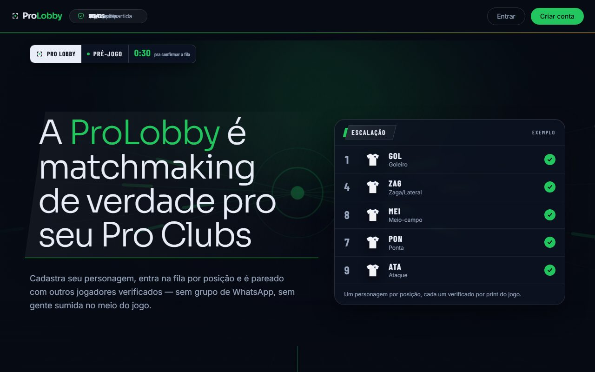
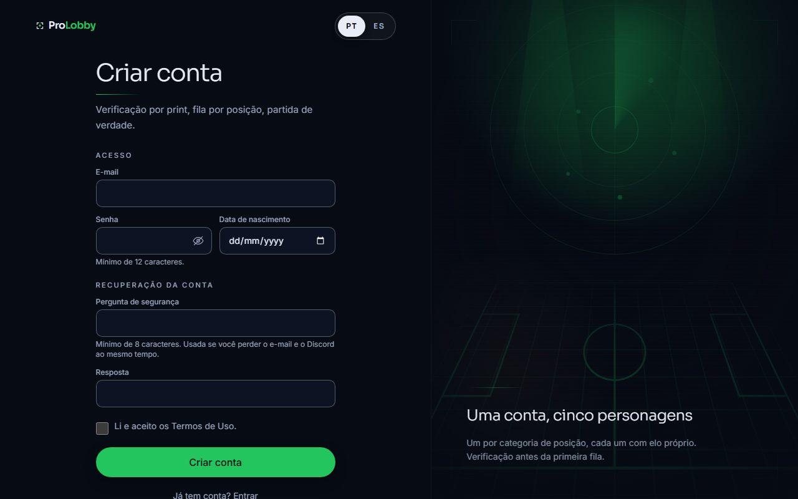
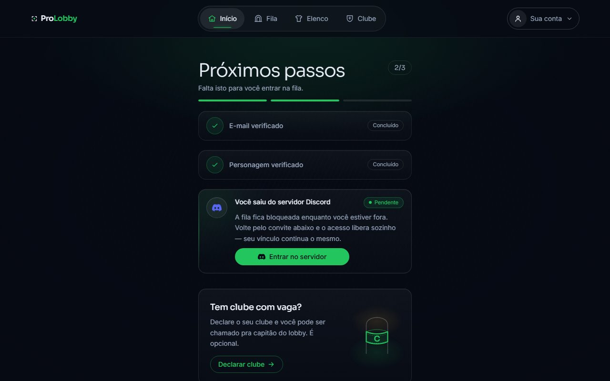
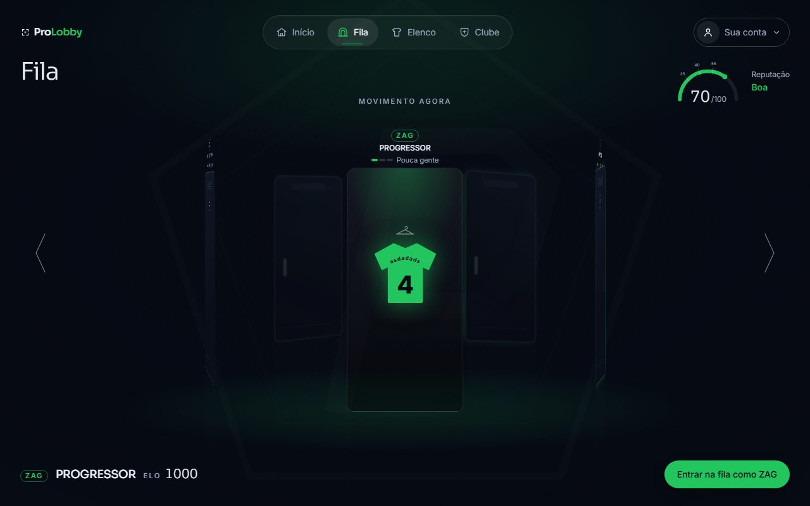
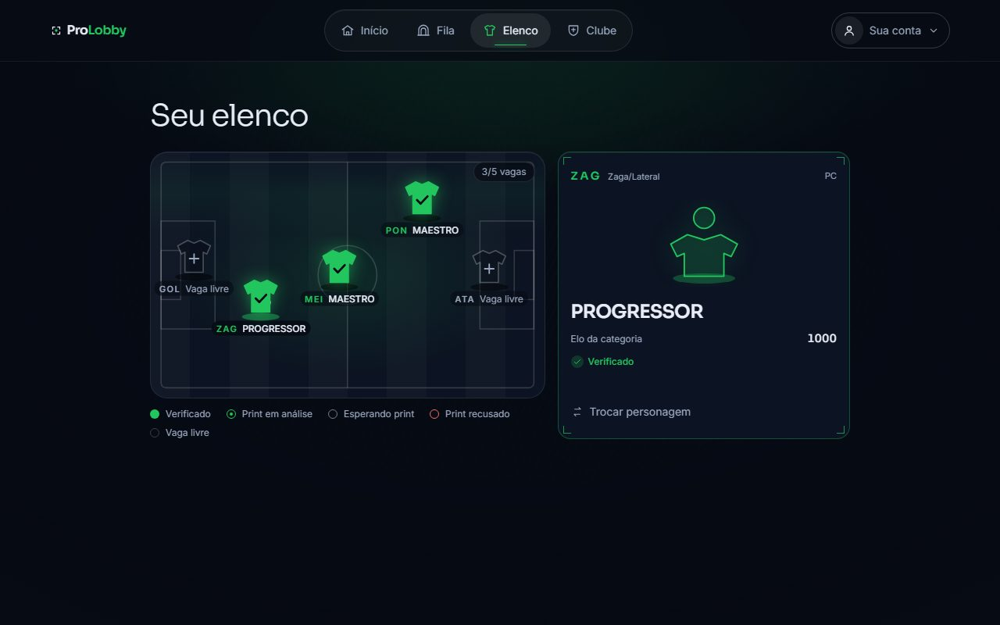
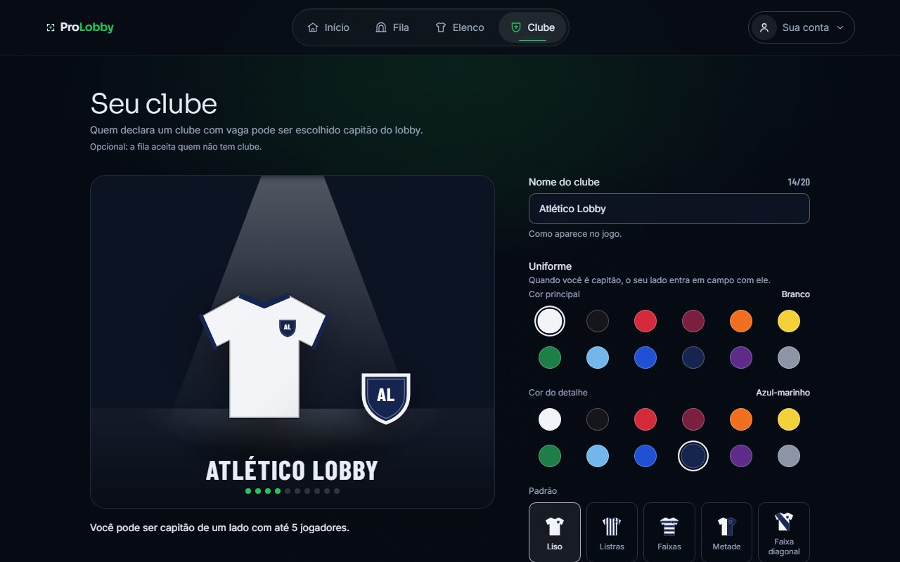
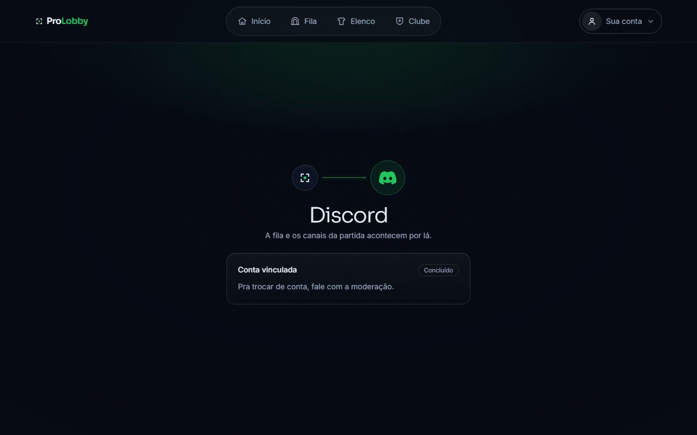
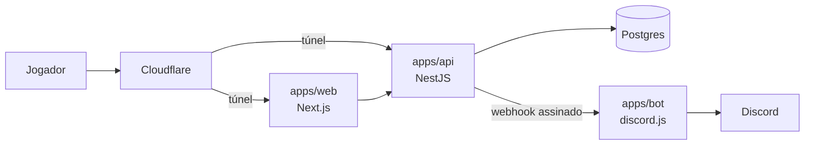

<div align="center">

# ProLobby

**Matchmaking competitivo e identidade verificada para EA FC Pro Clubs**

[](https://github.com/ljborgess/ProLobby.com/actions/workflows/ci.yml)


</div>

---

## Sobre

O jogador solo de Pro Clubs cadastra o personagem, prova que ele é dele com um print do jogo, entra
na fila pela posição que joga e é pareado com outros jogadores verificados. A partida acontece dentro
do EA FC; a ProLobby monta o jogo, coordena pelo Discord e mede o que aconteceu.

## Como funciona

| Etapa | O que acontece |
|---|---|
| **1. Conta** | E-mail verificado, pergunta de segurança pra recuperar sem e-mail, aceite dos [Termos](https://github.com/ljborgess/ProLobby.com/blob/dev/docs/produto/04-governanca/03-termos.md) |
| **2. Personagem** | Até 5 por conta, um por posição. O print da tela `Archetypes` prova a posse; a moderação confere até o OCR entrar |
| **3. Discord** | Vínculo por OAuth2. Sair do servidor bloqueia a fila até voltar |
| **4. Fila** | Entrada individual por posição. Dois lados equilibrados por elo; a IA do jogo completa as vagas vazias. A fila pausa quando não dá pra coordenar mais lobbies |
| **5. Lobby** | Confirmação em 30 s, capitão por reputação (quem declarou clube com vaga), votação de formação e canais de voz criados pelo bot |
| **6. Resultado** | Report do placar com print e confirmação cruzada. Disputa, contestação, avaliação entre companheiros e denúncia. Elo e reputação atualizam |

As regras completas, com o motivo de cada uma, estão no [dossiê de produto](docs/produto/README.md).

## As telas

Capturas do ambiente de desenvolvimento, com contas de teste. Toda ilustração é desenhada em SVG e
CSS: nada de print ou arte do EA FC.

| | |
|---|---|
|  |  |
| **Início**: a landing como transmissão de dia de jogo | **Criar conta**, com os Termos abrindo num popup |
|  |  |
| **Próximos passos**: o que falta pra entrar na fila | **Fila**: o vestiário, uma camisa por posição |
|  |  |
| **Elenco**: as cinco posições no campo | **Clube**: uniforme e escudo de quem pode ser capitão |
|  | |
| **Vínculo com o Discord** | |

## Status

| Fase | Estado |
|---|---|
| 1 CI, processo de PR, servidor Discord | Concluída |
| 2.1 Conta e autenticação | Concluída |
| 2.2 Personagem verificado por print | Em `dev`, menos o OCR ([#199](https://github.com/ljborgess/ProLobby.com/issues/199)), que espera o piloto ([#191](https://github.com/ljborgess/ProLobby.com/issues/191)) |
| 2.3 Vínculo com o Discord | Concluída |
| 2.4 Elo e reputação | Em `dev`, com a partida finalizada virando evento de elo |
| 2.5 Fila e matchmaking | Em `dev`: entrar e sair, montador, confirmação de 30 s, pausa da fila, clube declarado com uniforme e escudo |
| 3 Fechamento do lobby | Em `dev`: capitão, convite, formação, desistência do capitão, canais de voz do bot |
| 4.1 Report de resultado | Em `dev`: report com print, confirmação cruzada, contestação, expiração por falta de report |
| 4.2 Disputa e escada de punição | Em `dev`: disputa, avaliação por pares, denúncia, escada de punição, apelação |
| 4.3 Perfil público e ranking | A seguir |

Os Termos de Uso existem como rascunho em revisão jurídica, em `/termos`. A moderação fica fora do
menu e responde 404 pra quem não é moderador. Roadmap completo no
[PRD Mestre](https://github.com/ljborgess/ProLobby.com/issues/64).

## Arquitetura



A API concentra a regra de negócio. O front-end não decide autorização, e o bot só executa o que a
API manda. Monorepo com Turborepo e pnpm; decisões em [ADRs](docs/adr/README.md).

## Começando

Requer Node.js 22, pnpm 10 e Docker.

```bash
git clone git@github.com:ljborgess/ProLobby.com.git && cd ProLobby.com
git checkout dev && pnpm install
docker compose up -d postgres            # porta ocupada? POSTGRES_PORT=5442 docker compose up -d postgres
cp apps/api/.env.example apps/api/.env
cp apps/bot/.env.example apps/bot/.env   # preencha os segredos (abaixo)
pnpm --filter @prolobby/api mikro-orm migration:up
pnpm dev                                 # web :3000 · api :3001 · bot :3002
```

Segredos obrigatórios da API: `JWT_SECRET` e `WEBHOOK_SECRET` (`openssl rand -base64 48`),
`EVIDENCE_ENCRYPTION_KEY` e `IDENTITY_HMAC_SECRET` (`openssl rand -base64 32`). A API não sobe com
valor vazio ou de exemplo.

Qualidade: `pnpm format:check`, `pnpm lint`, `pnpm type-check`, `pnpm test` e `pnpm e2e`. O e2e só roda
em banco cujo nome termina em `_e2e`.

## Documentação

| | |
|---|---|
| [Guia do time](docs/time/README.md) | Primeiro dia, fluxo de issue, recados |
| [Produto](docs/produto/README.md) · [Parâmetros](docs/produto/parametros.md) | Regras e todos os números do sistema |
| [Requisitos](docs/requisitos/README.md) · [Segurança](docs/requisitos/08-seguranca-checklist.md) | Requisitos, modelo de dados e checklist de segurança |
| [Negócio](docs/negocio/README.md) | Mercado, ordem de implementação e lançamento |

Pra contribuir, siga o [`CONTRIBUTING.md`](CONTRIBUTING.md).

## Licença

Projeto privado. Todos os direitos reservados aos sócios.
